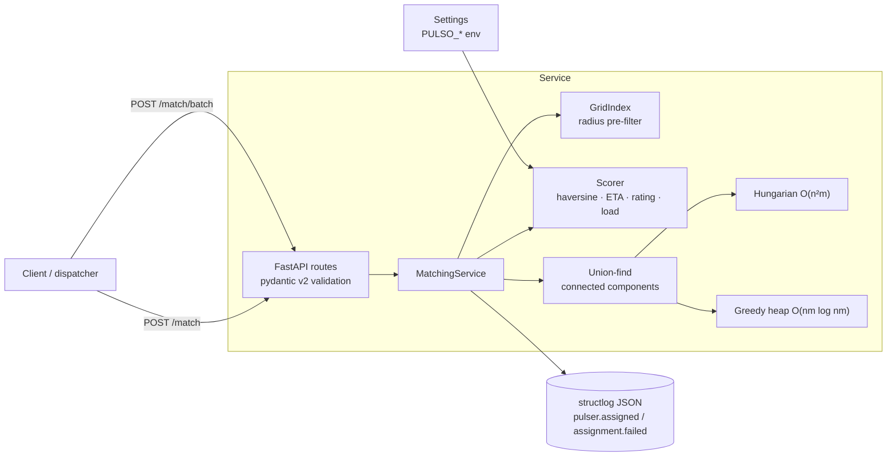

# pulso-matching

A FastAPI service that decides **which pulser should take which order**. It ranks candidates for a
single order and solves batch dispatch (N orders × M pulsers) as a min-cost bipartite assignment
with a from-scratch **Hungarian algorithm**, a greedy baseline, and a spatial grid index so large
inputs don't pay for every order–pulser pair.

> Pulso is a fictional company used to explore these patterns: an on-demand micro-task
> marketplace in LatAm where merchants post orders and independent "pulsers" pick them up.

## Architecture



Batch pipeline (`src/pulso_matching/service.py`):

1. Drop pulsers that are offline or at `maxTasks`; insert the rest into a lat/lng grid — **O(m)**.
2. For every order, query the grid for pulsers within `maxRadiusKm` and score only those —
   **O(n·k)** with `k` neighbours, instead of **O(n·m)**.
3. Split the bipartite candidate graph into connected components (union-find). Orders in different
   components never compete, so each is solved on its own: Σ O(nᵢ²·mᵢ) instead of O(n²·m).
4. Solve each component with the chosen strategy; orders left without a feasible pulser are
   returned in `unassignedOrderIds` and logged as `assignment.failed`.

```
src/pulso_matching/
├── main.py              FastAPI app, request-id + access-log middleware
├── service.py           rank() and assign_batch() use-cases
├── scoring.py           weighted cost in [0, 1]
├── spatial.py           GridIndex[T]
├── geo.py               haversine
├── assignment/
│   ├── hungarian.py     Kuhn–Munkres with potentials
│   └── greedy.py        heap-based baseline
├── models.py            pydantic v2 models (camelCase on the wire)
├── config.py            pydantic-settings (weights, speeds, radius)
└── logging_config.py    structlog JSON / console
benchmarks/bench_assignment.py
```

## API

| Method | Path | Purpose |
|---|---|---|
| `GET` | `/health` | Liveness + version |
| `POST` | `/match` | One order → top-`limit` candidates, best first |
| `POST` | `/match/batch` | N orders × M pulsers → assignment (`strategy`: `hungarian` \| `greedy`) |

Models follow the shared Pulso contract. Unknown fields are ignored, so a full `Order`
(`merchantId`, `status`, `items`, `amountCents`, …) can be posted as-is; matching uses `id` and
`pickup`.

```bash
curl -s localhost:8000/match/batch -H 'content-type: application/json' -d '{
  "strategy": "hungarian",
  "orders":  [{"id": "6f1c2a9e-0000-4000-8000-000000000001",
               "pickup": {"lat": 19.4326, "lng": -99.1332, "address": "Zócalo"}}],
  "pulsers": [{"id": "p1", "name": "Ana", "location": {"lat": 19.44, "lng": -99.13},
               "rating": 4.8, "activeTasks": 1, "maxTasks": 3, "vehicle": "BIKE", "online": true}]
}'
```

```json
{
  "strategy": "hungarian",
  "assignments": [{"orderId": "6f1c2a9e-0000-4000-8000-000000000001", "pulserId": "p1",
                   "score": 0.8158, "etaMinutes": 9.2, "assignedAt": "2026-11-03T20:22:36.096808Z"}],
  "unassignedOrderIds": [],
  "totalScore": 0.8158,
  "elapsedMs": 0.135
}
```

Interactive docs at `/docs` once running.

## Scoring

For a pair (order *o*, pulser *p*) the pulser must be online, below `maxTasks`, and within
`PULSO_MAX_RADIUS_KM` of the pickup. Otherwise the pair is infeasible. Feasible pairs get a cost
in `[0, 1]` (lower is better):

```
d    = haversine(p.location, o.pickup)                          # km
eta  = overhead + d · road_factor / speed(vehicle) · 60         # minutes
cost = w_d · d / max_radius
     + w_eta · min(eta / max_eta, 1)
     + w_rating · (1 − rating / 5)
     + w_load · activeTasks / maxTasks
score = 1 − cost
```

The weights are normalised to sum to 1, so only their ratios matter. Every value is a
`PULSO_*` env var (`config.py`):

| Variable | Default | Meaning |
|---|---|---|
| `PULSO_WEIGHT_DISTANCE` / `_ETA` / `_RATING` / `_LOAD` | 0.2 / 0.4 / 0.2 / 0.2 | relative weights |
| `PULSO_MAX_RADIUS_KM` | 8 | hard cut-off and grid cell size |
| `PULSO_MAX_ETA_MINUTES` | 45 | ETA at which that component saturates |
| `PULSO_SPEED_{BIKE,MOTO,CAR}_KMH` | 14 / 28 / 22 | urban averages (motos beat cars in traffic) |
| `PULSO_ROAD_FACTOR` | 1.3 | straight line → road distance |
| `PULSO_PICKUP_OVERHEAD_MINUTES` | 3 | parking, handover |
| `PULSO_LOG_LEVEL`, `PULSO_LOG_JSON` | INFO, true | logging |

## Algorithms and complexity

| Piece | Time | Memory | Notes |
|---|---|---|---|
| Haversine | O(1) | O(1) | spherical Earth, < 0.5 % error vs. ellipsoid |
| `/match` ranking | O(m log limit) | O(limit) | `heapq.nsmallest` over scored pulsers |
| Grid build / query | O(m) / O(min(c, o) + k) | O(m) | c = cells touched, o = occupied cells, k = points in them |
| Hungarian | **O(n²·m)**, n ≤ m (O(n³) square) | O(n·m) | transposes when n > m |
| Greedy | **O(nm · log nm)** | O(nm) | heapify all feasible pairs, pop until min(n, m) matched |
| Components | ~O(E) | O(n + m) | union-find with path halving |

**Hungarian** (`assignment/hungarian.py`) is the potentials formulation of Kuhn–Munkres: each row
is added with a Dijkstra-like sweep over columns that keeps reduced costs
`c[i][j] − u[i] − v[j]` non-negative, then augments along the shortest alternating path.
Infeasible pairs become a penalty `BIG` larger than any possible difference in total real cost,
so the optimisation is lexicographic: **first maximise the number of matched orders, then
minimise cost**. Penalised pairs are dropped from the output.

**Greedy** (`assignment/greedy.py`) takes the globally cheapest free pair each time. It is fast
and usually close, but it has no optimality guarantee for min-cost assignment, and it can strand
an order by giving away its only feasible pulser. `test_hungarian_saves_order_that_greedy_strands`
shows that case on a map.

### Spatial pre-filter trade-offs

`GridIndex` buckets points into fixed lat/lng cells (geohash-style bucketing without the base-32
encoding), with the cell size equal to the search radius so a query touches about 3×3 cells.

- Results are **exact**: the grid only narrows the search and every hit is confirmed with
  haversine. The property test `test_query_equals_linear_scan` checks this against a linear scan
  on random inputs, including poles and the antimeridian.
- The square box around a circle means up to ~65 % of scanned points are false positives. That is
  cheap compared with scoring all *m*.
- Cells are snapped to tile the globe, so columns wrap cleanly at ±180°. Near the poles the
  longitude span widens by `1/cos(lat)`, falling back to whole latitude bands.
- If a query box covers more cells than are occupied (huge radius, tiny cells), the index walks
  the occupied cells instead. It is never worse than a linear scan.
- Fixed cells don't adapt to density. A single hotspot degrades toward O(m) per query. A quadtree
  or H3 would adapt, but city-scale dispatch with a few-km radius doesn't need that complexity.

## Benchmarks

`python -m benchmarks.bench_assignment` generates random instances around Mexico City
(pulsers = 1.5 × orders, random rating/load/vehicle, seed 42). It asserts that the grid finds
exactly the same candidate pairs as all-pairs scoring, and that the component-split service
matches as many orders as the monolithic Hungarian. Columns: *hungarian/greedy ms* are the solver
alone on the full matrix. *service ms* is the end-to-end `assign_batch` (grid + components +
Hungarian + building response models). *greedy gap* is the greedy average cost per matched order
relative to Hungarian.

Measured on an Intel i9-9980HK (2.4 GHz), CPython 3.14, single thread. Expect ±20 % run to run.

**Dense city: 33 × 33 km** (`--sizes 50 100 200 400 800`)

| orders | pulsers | feasible pairs | components | grid ms | all-pairs ms | hungarian ms | greedy ms | service ms | matched H / G | avg cost H / G | greedy gap |
|---:|---:|---:|---:|---:|---:|---:|---:|---:|:---:|:---:|---:|
| 50 | 75 | 559 | 1 | 3.3 | 5.8 | 1.8 | 0.3 | 6.0 | 50 / 50 | 0.2568 / 0.2657 | +3.5 % |
| 100 | 150 | 2318 | 1 | 11.5 | 24.7 | 6.9 | 1.8 | 21.7 | 100 / 100 | 0.2095 / 0.2160 | +3.1 % |
| 200 | 300 | 9328 | 1 | 45.5 | 100.2 | 35.1 | 7.0 | 94.7 | 200 / 200 | 0.1723 / 0.1810 | +5.0 % |
| 400 | 600 | 35823 | 1 | 187.0 | 392.0 | 172.6 | 26.2 | 394.3 | 400 / 400 | 0.1448 / 0.1513 | +4.5 % |
| 800 | 1200 | 143317 | 1 | 738.6 | 1616.9 | 1006.2 | 161.3 | 2099.9 | 800 / 800 | 0.1296 / 0.1355 | +4.6 % |

**Sparse metro area: 150 × 150 km** (`--sizes 200 800 2000 --side-km 150`)

| orders | pulsers | feasible pairs | components | grid ms | all-pairs ms | hungarian ms | greedy ms | service ms | matched H / G | avg cost H / G | greedy gap |
|---:|---:|---:|---:|---:|---:|---:|---:|---:|:---:|:---:|---:|
| 200 | 300 | 477 | 45 | 4.9 | 94.7 | 114.9 | 1.7 | 8.6 | 159 / 144 | 0.3670 / 0.3434 | −6.4 % |
| 800 | 1200 | 8223 | 1 | 59.1 | 1520.0 | 716.7 | 53.6 | 1392.8 | 799 / 762 | 0.2760 / 0.2676 | −3.0 % |
| 2000 | 3000 | 51461 | 1 | 829.0 | 10755.2 | 5695.6 | 263.2 | 4519.5 | 2000 / 1989 | 0.2065 / 0.2148 | +4.0 % |

What the numbers say:

- **Quality.** When everyone can be matched, greedy costs about 3–5 % more per order than
  Hungarian. In sparse areas the bigger difference is coverage: greedy left **37 of 800** orders
  unassigned that Hungarian matched. Its average cost looks *lower* there only because it skipped
  the hard orders.
- **Grid pre-filter.** In a dense city about a quarter of all pairs are within 8 km, so the grid
  wins about 2×. In the sparse area it wins **13–26×**, because it skips pairs that could never be
  feasible.
- **Components.** At low density the candidate graph breaks into 45 independent pieces, and the
  end-to-end service (8.6 ms) beats the monolithic Hungarian on the same matrix (115 ms) by 13×.
  Once density passes the percolation threshold, a single giant component forms and the split
  stops helping.
- **Pure Python limit.** Hungarian is about 1 s at 800 × 1200 and about 6 s at 2000 × 3000. For a
  dispatch tick with thousands of orders you would run it per zone (the component split does this
  naturally when the radius is small), cap batch size, or swap in `scipy.optimize.linear_sum_assignment`
  (C, same O(n³)). The pure implementation is kept because showing the algorithm is the point.

## Decisions and trade-offs

- **One order per pulser per batch.** A batch is one dispatch tick. Once a pulser accepts, their
  load changes, and so does their score for everything else. Giving several orders to one pulser
  in the same tick would mean expanding them into capacity slots with load-dependent costs. That
  is possible (add one column per free slot), but it multiplies *m* and the Hungarian cost with it.
- **Maximise coverage before cost.** An unassigned order is worse for the business than a slightly
  slower pickup, so the `BIG` penalty makes the Hungarian objective lexicographic.
- **Cost, not score, inside the algorithms.** Minimising a `[0, 1]` cost keeps the solvers generic,
  and the API reports `score = 1 − cost` because humans read "higher is better".
- **Stateless service.** Pulser state comes in the request, so there is no stale cache to manage
  and scaling out is trivial. A production version would read pulser positions from a live store.
- **Straight-line ETA.** Haversine × road factor ÷ vehicle speed is a cheap, monotonic proxy.
  A routing engine (OSRM/Valhalla) would be more accurate but adds a network hop for every pair,
  so it fits better as a re-ranking step on the top-k only.
- **Structured logs.** Every request carries an `x-request-id` (generated if absent) that is bound
  into all log lines. Domain events use the shared Pulso names (`pulser.assigned` at debug level,
  `assignment.failed`) plus a `batch.matched` summary.

## Running it

```bash
python3 -m venv .venv && source .venv/bin/activate
pip install -e ".[dev]"
uvicorn pulso_matching.main:app --reload          # http://localhost:8000/docs
PULSO_LOG_JSON=false uvicorn pulso_matching.main:app   # human-readable logs
```

Docker (multi-stage, `python:3.14-slim`, non-root user, healthcheck):

```bash
docker build -t pulso-matching .
docker run -p 8000:8000 -e PULSO_MAX_RADIUS_KM=6 pulso-matching
```

## Testing

```bash
ruff check . && ruff format --check .
mypy                     # strict, src + tests + benchmarks
pytest                   # 49 tests, warnings are errors
python -m benchmarks.bench_assignment --sizes 50 100 200 400
```

- `test_geo.py`: known city-to-city distances, symmetry, bounds, and the triangle inequality
  (Hypothesis).
- `test_assignment.py`: Hungarian equals brute force (max cardinality, then min cost) on
  hundreds of random matrices up to 6 × 6, with infeasible pairs and negative costs. Greedy is
  always valid and never beats the optimum. A hand-built case shows greedy losing.
- `test_spatial.py`: grid queries equal a linear scan for random points, radii and cell sizes,
  plus the antimeridian.
- `test_service.py`: ranking order, component split, invariants on a random city, and grid
  candidates equal to all-pairs.
- `test_api.py`: httpx `TestClient` for every endpoint, camelCase contract, 422 validation,
  settings overrides, and request-id echo.

CI (`.github/workflows/ci.yml`) runs lint, mypy and tests on Python 3.12 and 3.14, plus a
benchmark smoke run. It then builds the Docker image and probes `/health` in a running container.

## What this demonstrates

- Implementing a classic combinatorial optimisation algorithm (Hungarian, O(n²m)) from scratch,
  with a clear argument for correctness and property-based verification against brute force.
- Choosing and measuring baselines: a greedy heap algorithm, its failure modes, and a reproducible
  benchmark that reports quality as well as speed.
- Spatial indexing for geo workloads and its trade-offs (exactness, poles, antimeridian, density).
- Graph decomposition (union-find components) to turn one big problem into many small ones.
- A typed Python service: FastAPI, pydantic v2 models and settings, `mypy --strict`, ruff,
  structured JSON logging with request correlation.
- Production hygiene: pinned dependencies, slim non-root Docker image with healthcheck, CI
  covering lint, types, tests and the container.

## License

MIT © 2026 Alejandro Álvarez
