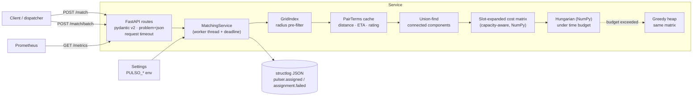

<p align="center"></p>

<p align="center"><a href="https://github.com/AlejandroAlvarez-srdev/pulso-matching/actions/workflows/ci.yml"></a>       </p>

<h1 align="center">pulso-matching</h1>
<!-- /header -->

A FastAPI service that decides **which pulser should take which order**. It ranks candidates for a
single order and solves batch dispatch (N orders × M pulsers) as a min-cost bipartite assignment:

- **Hungarian algorithm**, written from scratch, with a NumPy-vectorised variant that the service
  runs and a pure-Python reference.
- **Capacity-aware**: a pulser with spare capacity can take several orders in one batch.
- **Time budget**: when Hungarian runs past its budget, the batch falls back to greedy instead of
  timing out.
- **Spatial grid index** with cached pair scores, so large inputs don't pay for every
  order–pulser pair.

It exposes Prometheus metrics, returns RFC 9457 errors, and enforces a per-request timeout.

> Pulso is a fictional company used to explore these patterns: an on-demand micro-task
> marketplace in LatAm where merchants post orders and independent "pulsers" pick them up.

## At a glance

<table>
  <tr>
    <td align="center" width="25%"><b>182 incl. property-based</b><br>Tests</td>
    <td align="center" width="25%"><b>Hungarian vs brute force</b><br>Optimal</td>
    <td align="center" width="25%"><b>NumPy 3.5–8× faster</b><br>Speed</td>
    <td align="center" width="25%"><b>Budget → greedy fallback, 504 deadline</b><br>Resilience</td>
  </tr>
</table>

## Architecture



Batch pipeline (`src/pulso_matching/service.py`):

1. Insert eligible pulsers (online, below `maxTasks`) into a lat/lng grid: **O(m)**.
2. For each order, query the grid for pulsers within `maxRadiusKm`: **O(n·k)** for `k`
   neighbours, instead of **O(n·m)**. The haversine distance the grid already computed becomes a
   cached `PairTerms` (distance, base ETA, distance + rating cost). It is never recomputed.
3. Split the bipartite candidate graph into connected components (union-find). Each component is
   solved independently: Σ O(nᵢ²·mᵢ) instead of O(n²·m).
4. Per component, expand each pulser into its free **slots** and fill the cost matrix from the
   cache with one NumPy pass per slot level.
5. Solve components smallest first with Hungarian under a wall-clock budget. If the budget runs
   out, the remaining components are solved with greedy on the same matrices, and the response
   is flagged `degraded`.
6. If the *request* deadline passes, the work stops altogether and the client gets a 504.

```
src/pulso_matching/
├── main.py              FastAPI app, request-id/access-log/metrics middleware
├── service.py           rank() and assign_batch(): grid → cache → components → slots → solve
├── scoring.py           PairTerms cache, scalar + vectorised slot costs
├── spatial.py           GridIndex[T]
├── geo.py               haversine
├── assignment/
│   ├── hungarian_np.py  NumPy Kuhn–Munkres with deadline (used by the service)
│   ├── hungarian.py     pure-Python reference
│   └── greedy.py        heap-based baseline
├── timeouts.py          per-request timeout + cooperative deadline
├── limits.py            admission control: streamed body-size cap (413), list caps (422)
├── problems.py          RFC 9457 problem+json handlers
├── metrics.py           Prometheus registry
├── examples.py          OpenAPI request examples
├── models.py            pydantic v2 models (camelCase on the wire)
├── config.py            pydantic-settings
└── logging_config.py    structlog JSON / console
benchmarks/bench_assignment.py   solver / pre-filter / service benchmark
benchmarks/loadtest.py           closed-loop HTTP load test
```

## API

| Method | Path | Purpose |
|---|---|---|
| `GET` | `/health` | Liveness + version |
| `GET` | `/metrics` | Prometheus exposition |
| `POST` | `/match` | One order → top-`limit` candidates, best first |
| `POST` | `/match/batch` | N orders × M pulsers → assignment (`strategy`: `hungarian` \| `greedy`) |

Models follow the shared Pulso contract. Unknown fields are ignored, so a full `Order`
(`merchantId`, `status`, `items`, `amountCents`, …) can be posted as-is; matching uses `id` and
`pickup`. `/docs` ships realistic Mexico City request examples. The test suite posts every one of
them, so they can't go stale.

```bash
curl -s localhost:8000/match/batch -H 'content-type: application/json' -d '{
  "strategy": "hungarian",
  "orders":  [{"id": "6f1c2a9e-0000-4000-8000-000000000001",
               "pickup": {"lat": 19.4326, "lng": -99.1332, "address": "Zócalo"}}],
  "pulsers": [{"id": "p1", "name": "Ana", "location": {"lat": 19.44, "lng": -99.13},
               "rating": 4.8, "activeTasks": 1, "maxTasks": 3, "vehicle": "BIKE", "online": true}]
}'
```

```json
{
  "strategy": "hungarian",
  "assignments": [{"orderId": "6f1c2a9e-0000-4000-8000-000000000001", "pulserId": "p1",
                   "score": 0.8158, "etaMinutes": 9.2, "assignedAt": "2026-11-03T20:22:36.096808Z"}],
  "unassignedOrderIds": [],
  "totalScore": 0.8158,
  "elapsedMs": 0.135,
  "degraded": false,
  "degradedComponents": 0
}
```

### Errors (RFC 9457)

Every error is `application/problem+json` with the same shape. This covers validation, unknown
route, wrong method, timeout and unhandled exceptions. A 500 never leaks the exception text; the
`x-request-id` correlates it with the logs.

```json
{
  "type": "https://errors.pulso.example/validation",
  "title": "Request validation failed",
  "status": 422,
  "detail": "1 invalid field",
  "instance": "/match",
  "errors": [{"loc": ["body", "pulsers", 0, "rating"],
              "msg": "Input should be less than or equal to 5", "type": "less_than_equal"}]
}
```

| Status | `type` | When |
|---|---|---|
| 413 | `…/payload-too-large` | body larger than `PULSO_MAX_BODY_BYTES` (sent with `connection: close`) |
| 422 | `…/validation` | body fails pydantic validation, or more orders/pulsers than allowed (`errors[]` per field) |
| 404 / 405 | `about:blank` | unknown route / wrong method |
| 504 | `…/timeout` | request exceeded `PULSO_REQUEST_TIMEOUT_MS` |
| 500 | `…/internal` | unhandled exception (logged with traceback) |

### Metrics

| Metric | Type | Labels |
|---|---|---|
| `pulso_http_request_duration_seconds` | histogram | `method`, `route` (path template, or `unmatched`), `status` |
| `pulso_assignments_total` | counter | `strategy` |
| `pulso_unassigned_orders_total` | counter | `strategy` |
| `pulso_degraded_batches_total` | counter | |
| `pulso_batch_orders` | histogram | |

The metrics use a dedicated registry, not the process default. Route labels are templates, so
cardinality stays bounded. With `uvicorn --workers N`, each worker keeps its own counters (no
multiprocess mode), so scrape the workers individually or run one worker per container.

## Scoring

For a pair (order *o*, pulser *p*) the pulser must be online, below `maxTasks`, and within
`PULSO_MAX_RADIUS_KM` of the pickup. Otherwise the pair is infeasible. Feasible pairs get a cost
in `[0, 1]` (lower is better). `slot` is how many orders this pulser already got in the current
batch (0 for `/match`):

```
d    = haversine(p.location, o.pickup)                               # km
eta  = overhead + d · road_factor / speed(vehicle) · 60 + slot · stacked_delay
cost = w_d · d / max_radius + w_rating · (1 − rating / 5)            # cached per pair (PairTerms)
     + w_eta · min(eta / max_eta, 1)
     + w_load · (activeTasks + slot) / maxTasks                      # per slot
score = 1 − cost
```

The weights are normalised to sum to 1. Every value is a `PULSO_*` env var (`config.py`):

| Variable | Default | Meaning |
|---|---|---|
| `PULSO_WEIGHT_DISTANCE` / `_ETA` / `_RATING` / `_LOAD` | 0.2 / 0.4 / 0.2 / 0.2 | relative weights |
| `PULSO_MAX_RADIUS_KM` | 8 | hard cut-off and grid cell size |
| `PULSO_MAX_ETA_MINUTES` | 45 | ETA at which that component saturates |
| `PULSO_SPEED_{BIKE,MOTO,CAR}_KMH` | 14 / 28 / 22 | urban averages (motos beat cars in traffic) |
| `PULSO_ROAD_FACTOR` | 1.3 | straight line → road distance |
| `PULSO_PICKUP_OVERHEAD_MINUTES` | 3 | parking, handover |
| `PULSO_MAX_ORDERS_PER_PULSER_PER_BATCH` | 3 | slot cap (also limited by `maxTasks − activeTasks`) |
| `PULSO_STACKED_ORDER_DELAY_MINUTES` | 12 | extra ETA per order already stacked on the pulser |
| `PULSO_HUNGARIAN_BUDGET_MS` | 300 | wall-clock budget before degrading to greedy |
| `PULSO_REQUEST_TIMEOUT_MS` | 2000 | hard limit per request (504 past it) |
| `PULSO_MAX_BODY_BYTES` | 4 MiB | body size cap, counted while streaming (413 past it) |
| `PULSO_MAX_BATCH_ORDERS` / `PULSO_MAX_PULSERS` | 2000 / 5000 | list caps per request (422 past them) |
| `PULSO_LOG_LEVEL`, `PULSO_LOG_JSON` | INFO, true | logging |

## Algorithms and complexity

| Piece | Time | Memory | Notes |
|---|---|---|---|
| Haversine | O(1) | O(1) | spherical Earth, < 0.5 % error vs. ellipsoid |
| `/match` ranking | O(m log limit) | O(limit) | `heapq.nsmallest` over scored pulsers |
| Grid build / query | O(m) / O(min(c, o) + k) | O(m) | c = cells touched, o = occupied cells, k = points in them |
| Pair cache + matrices | O(E + E·S) | O(n·Σslots) | E = feasible pairs, S = max slots; one NumPy pass per slot |
| Hungarian | **O(n²·M)**, n ≤ M (O(n³) square) | O(n·M) | M = Σ slots; transposes when n > M |
| Greedy | **O(nM · log nM)** | O(nM) | heapify all feasible pairs, pop until min(n, M) matched |
| Components | ~O(E) | O(n + m) | union-find with path halving |

### Hungarian, pure and vectorised

`assignment/hungarian.py` is the potentials formulation of Kuhn–Munkres. Each row is added with a
Dijkstra-like sweep over columns that keeps reduced costs `c[i][j] − u[i] − v[j]` non-negative,
then augments along the shortest alternating path. Infeasible pairs become a penalty `BIG` larger
than any possible difference in total real cost. That makes the optimisation lexicographic:
**first maximise the number of matched orders, then minimise cost**.

`assignment/hungarian_np.py` is the same algorithm with the column sweep (updating `minv`,
picking the free column with `argmin`, shifting the potentials) done as O(m) NumPy array
operations. The Python loop runs once per tree-growth step instead of once per column. The
complexity is unchanged, but the constants are 3.5–8× better from 400 orders up. It also takes a
`perf_counter` deadline, checked once per inserted row. Property tests check both variants
against brute force, and against each other on instances up to 40 × 40. Because both of those
oracles are this repo's own code, a differential suite also checks them against SciPy (a
dev-only dependency) on rectangular instances up to 300 × 200 with 5–100 % feasible pairs and
frequent ties: the match count must equal SciPy's Hopcroft–Karp maximum matching and the cost
must equal `linear_sum_assignment`'s optimum over maximum matchings.

**Greedy** (`assignment/greedy.py`) takes the globally cheapest free pair each time. It is fast,
but it has no optimality guarantee for min-cost assignment, and it can strand an order by giving
away its only feasible pulser. `test_hungarian_saves_order_that_greedy_strands` builds that case
on a map.

### Capacity-aware assignment

A pulser with `s = min(maxTasks − activeTasks, PULSO_MAX_ORDERS_PER_PULSER_PER_BATCH)` free slots
becomes `s` columns. Column `k` is "their (k+1)-th order this batch": its load term uses
`activeTasks + k`, and its ETA waits `k · stacked_delay` because the earlier orders come first.
For any order, cost never decreases with `k` (a `k · 1e-9` tie-breaker makes it strictly
increasing). So any optimal solution fills a pulser's slots in order, and the one-to-one solvers
solve the many-to-one problem exactly. A Hypothesis test checks this against brute force over
every capacity-respecting mapping *and* every slot sequencing. The cost is a wider matrix: M
becomes Σ slots, which Hungarian pays for linearly.

### Pair-term cache

The cost splits into a pair part (distance, rating, travel time) and a slot part (load,
stacking). The pair part is computed once, from the distance the grid query already returned, and
reused for every slot column, every component matrix, a greedy fallback, and the final reported
scores. Without the cache, the capacity-aware batch re-scored every (pair, slot) and took ~3.7 s
at 800 × 1200. With the cache and the vectorised matrix build it takes ~0.9 s.

### Time budget and graceful degradation

Hungarian is O(n²·M). At dispatch time, a slightly worse assignment returned in time beats an
optimal one the dispatcher has already given up on. So:

- `PULSO_HUNGARIAN_BUDGET_MS` gives Hungarian a wall-clock deadline (capped by the request
  deadline). Components run smallest first, so the cheap ones still get the optimum. When the
  deadline passes mid-solve, that component and every remaining one are solved greedily **from
  the same cached matrix**. The response reports `degraded: true` and `degradedComponents`, the
  `pulso_degraded_batches_total` counter is incremented, and a `batch.degraded` warning is logged.
- `PULSO_REQUEST_TIMEOUT_MS` bounds the whole request. The solver runs in a worker thread under
  `anyio.fail_after`. On expiry the client gets a 504 problem straight away, and the thread is
  abandoned (Python threads cannot be killed). The same deadline is passed into the service,
  which checks it per order while scoring, before each component, and per row inside Hungarian,
  so abandoned work stops instead of competing for the GIL. The load test found this was
  necessary (see below).
- `PULSO_REQUEST_TIMEOUT_MS` only starts once the handler runs, i.e. after the body has been
  read, decoded and validated on the event loop. **Admission control** (`limits.py`) bounds that
  part: a pure ASGI middleware counts body bytes as they arrive and refuses with a 413 past
  `PULSO_MAX_BODY_BYTES`. A declared `Content-Length` over the limit is refused before anything
  is read, and a chunked or understated body is cut off on the chunk that crosses it, so a
  client can't make the worker parse 100 MB of JSON. The order and pulser caps then bound the
  solver (Hungarian is O(n²·M)). The defaults leave room for the largest benchmark below
  (2000 × 3000): a pulser is ~190 bytes of JSON and an order ~115.
- The budget is **wall-clock**, so under CPU contention more batches degrade. That is the
  intended load-shedding behaviour: when the box is busy, the service trades a few percent of
  assignment quality for latency rather than queueing.

### Spatial pre-filter trade-offs

`GridIndex` buckets points into fixed lat/lng cells (geohash-style bucketing without the base-32
encoding), with the cell size equal to the search radius so a query touches about 3×3 cells.

- Results are **exact**: the grid only narrows the search and every hit is confirmed with
  haversine. Property tests compare queries with a linear scan on random inputs. Dedicated
  strategies focus on the antimeridian, both poles, exact ±90/±180 values, zero radius and cells
  larger than the globe. These tests found a real bug: inserts used `x // c` and queries used
  `floor(x / c)`, which disagree by one cell when `x` falls exactly on a cell boundary. Both now
  share one helper.
- The square box around a circle means up to ~65 % of scanned points are false positives. That is
  cheap compared with scoring all *m*.
- Cells are snapped to tile the globe, so columns wrap cleanly at ±180°. Near the poles the
  longitude span widens by `1/cos(lat)`, falling back to whole latitude bands.
- If a query box covers more cells than are occupied, the index walks the occupied cells instead.
  It is never worse than a linear scan.
- Fixed cells don't adapt to density. A quadtree or H3 would, but city-scale dispatch with a
  few-km radius doesn't need that complexity.

## Benchmarks

`python -m benchmarks.bench_assignment` generates random instances around Mexico City
(pulsers = 1.5 × orders, random rating/load/vehicle, seed 42). Timings are the **best of 3**. It
asserts four things:

- The grid finds exactly the same candidate pairs as all-pairs scoring.
- Both Hungarian variants agree.
- The component-split service matches as many orders as one monolithic solve.
- The capacity-aware service matches at least that many.

The columns are:

- **hungarian py / np / greedy:** each solver alone on the full one-order-per-pulser matrix.
- **service:** end-to-end `assign_batch` with one slot per pulser (grid, cache, components,
  Hungarian, response models).
- **cap-aware:** the default capacity-aware service.
- **greedy gap:** greedy's average cost per matched order relative to Hungarian.

Measured on an Intel i9-9980HK (8 cores / 16 threads), CPython 3.14, NumPy 2.5. **The machine was
shared** and the load average was 15–19 during these runs, so absolute numbers are pessimistic.
Treat the ratios as the result.

**Dense city: 33 × 33 km** (`--sizes 50 100 200 400 800`)

| orders | pulsers | feasible pairs | components | grid ms | all-pairs ms | hungarian py ms | hungarian np ms | greedy ms | service ms | cap-aware ms | matched H / G / cap | avg cost H / G | greedy gap |
|---:|---:|---:|---:|---:|---:|---:|---:|---:|---:|---:|:---:|:---:|---:|
| 50 | 75 | 559 | 1 | 3.8 | 12.6 | 3.4 | 4.3 | 0.6 | 9.8 | 9.8 | 50 / 50 / 50 | 0.2568 / 0.2657 | +3.5 % |
| 100 | 150 | 2318 | 1 | 14.3 | 51.2 | 12.6 | 9.5 | 2.8 | 27.1 | 27.9 | 100 / 100 / 100 | 0.2095 / 0.2160 | +3.1 % |
| 200 | 300 | 9328 | 1 | 55.6 | 209.4 | 64.7 | 28.2 | 12.4 | 97.2 | 98.9 | 200 / 200 / 200 | 0.1723 / 0.1810 | +5.0 % |
| 400 | 600 | 35823 | 1 | 198.2 | 795.4 | 279.9 | 79.8 | 44.5 | 297.9 | 307.3 | 400 / 400 / 400 | 0.1448 / 0.1513 | +4.5 % |
| 800 | 1200 | 143317 | 1 | 745.5 | 2505.2 | 1197.1 | 219.0 | 183.8 | 889.5 | 888.9 | 800 / 800 / 800 | 0.1296 / 0.1355 | +4.6 % |

**Sparse metro area: 150 × 150 km** (`--sizes 200 800 2000 --side-km 150`)

| orders | pulsers | feasible pairs | components | grid ms | all-pairs ms | hungarian py ms | hungarian np ms | greedy ms | service ms | cap-aware ms | matched H / G / cap | avg cost H / G | greedy gap |
|---:|---:|---:|---:|---:|---:|---:|---:|---:|---:|---:|:---:|:---:|---:|
| 200 | 300 | 477 | 45 | 3.7 | 89.5 | 114.2 | 42.8 | 2.0 | 16.0 | 16.9 | 159 / 144 / 172 | 0.3670 / 0.3434 | −6.4 % |
| 800 | 1200 | 8223 | 1 | 42.8 | 1418.7 | 566.5 | 108.3 | 38.8 | 134.2 | 131.5 | 799 / 762 / 800 | 0.2760 / 0.2676 | −3.0 % |
| 2000 | 3000 | 51461 | 1 | 235.9 | 8675.5 | 7240.1 | 892.6 | 478.9 | 1018.5 | 1238.9 | 2000 / 1989 / 2000 | 0.2065 / 0.2148 | +4.0 % |

What the numbers say:

- **NumPy Hungarian.** On tiny matrices it ties with or slightly loses to pure Python (array
  overhead). At 400+ it is 3.5–8× faster: 1.2 s → 0.22 s at 800 × 1200 and 7.2 s → 0.9 s at
  2000 × 3000.
- **Quality.** When everyone can be matched, greedy costs 3–5 % more per order. In sparse areas
  the bigger difference is coverage: greedy left 37 of 800 orders unassigned that Hungarian
  matched. Greedy's average looks *lower* there only because it skipped the hard orders.
- **Capacity.** Letting pulsers take several orders raises coverage in sparse areas (159 → 172
  of 200; 799 → 800). Thanks to the cache, it costs almost nothing extra.
- **Grid pre-filter.** About 3–4× faster than all-pairs in a dense city and 24–37× faster in the
  sparse area.
- **End to end.** At 800 × 1200 the one-slot service went from ~2.1 s in the first version (pure
  Hungarian, re-scoring every pair) to ~0.9 s. In the sparse 200-order case the 45-component
  split solves in 16 ms, against 43–114 ms for one solve over the whole matrix.

## Load test

`benchmarks/loadtest.py` is a closed-loop asyncio + httpx client. Each of `--concurrency` workers
sends a request and immediately sends the next one when the answer arrives. Payloads are
pre-encoded, and the workers are spread across `--processes` client processes. The first version
used a single client process and saturated one core at ~150 req/s of 30 KB bodies, so it was
measuring itself. Payloads are random Mexico City instances of the given size.

```bash
uvicorn pulso_matching.main:app --workers 4 --no-access-log &
python -m benchmarks.loadtest --header --endpoint batch --orders 50 --pulsers 75 --concurrency 16
```

Same shared machine as above, 15 s per row, client and server on the same box, default settings
(300 ms Hungarian budget, 2 s request timeout). *errors* are 504s.

**1 uvicorn worker**

| endpoint | size | strategy | concurrency | requests | req/s | p50 ms | p95 ms | p99 ms | mean ms | errors | degraded |
|---|---|---|---:|---:|---:|---:|---:|---:|---:|---:|---:|
| /match | 1 x 200 | - | 16 | 1459 | 96.9 | 138.4 | 312.4 | 365.7 | 164.9 | 0 | 0 |
| /match/batch | 50 x 75 | hungarian | 8 | 682 | 44.6 | 156.5 | 315.7 | 402.7 | 178.9 | 0 | 0 |
| /match/batch | 50 x 75 | greedy | 8 | 664 | 43.9 | 162.2 | 286.5 | 336.6 | 181.6 | 0 | 0 |
| /match/batch | 200 x 300 | hungarian | 4 | 76 | 4.9 | 744.2 | 1248.3 | 1294.4 | 809.7 | 0 | 76 |
| /match/batch | 500 x 750 | hungarian | 4 | 28 | 1.8 | 2229.6 | 2338.4 | 2342.6 | 2235.7 | 28 | 0 |

**4 uvicorn workers**

| endpoint | size | strategy | concurrency | requests | req/s | p50 ms | p95 ms | p99 ms | mean ms | errors | degraded |
|---|---|---|---:|---:|---:|---:|---:|---:|---:|---:|---:|
| /match | 1 x 200 | - | 32 | 5224 | 346.7 | 89.2 | 167.6 | 209.0 | 92.0 | 0 | 0 |
| /match/batch | 50 x 75 | hungarian | 16 | 2177 | 144.0 | 95.5 | 218.9 | 262.9 | 110.7 | 0 | 0 |
| /match/batch | 200 x 300 | hungarian | 8 | 362 | 23.6 | 358.8 | 518.5 | 598.2 | 334.3 | 0 | 193 |

What the load test taught:

- **At small batch sizes, the solver is not the bottleneck.** Hungarian and greedy give the same
  throughput for 50 × 75. The time goes into JSON parsing, pydantic validation and scoring. Going
  further would mean `orjson` responses, or moving validation off the event loop.
- **Workers scale roughly linearly** (3.2–4.8× with 4 workers) until client and server compete
  for the same 8 cores. An earlier run on a quieter machine reached 191 req/s (1 worker) and
  577 req/s (4 workers) on `/match`.
- **The budget works as load shedding.** A lone 200 × 300 batch solves in ~100 ms, but with four
  concurrent batches sharing the GIL, the wall-clock budget runs out. Every batch was
  `degraded`, which kept p99 under 1.3 s instead of letting it grow with the queue.
- **500 × 750 at concurrency 4 does not fit in a 2 s timeout on one worker**, and every request
  got a 504. This exposed a bug: the first runs returned those 504s at p50 2.9 s / p99 3.6 s,
  because abandoned threads kept scoring and running greedy, holding the GIL the event loop
  needed to send the 504. With cooperative deadlines in the service, 504s arrive at
  p50 2.2 s / p99 2.3 s, even with more background load. The remaining ~0.2 s over the timeout is
  most likely request-body parsing and validation, which run on the event loop before the timeout
  starts. That work is now bounded by the body-size and list caps described above.

## Decisions and trade-offs

- **Maximise coverage before cost.** An unassigned order is worse for the business than a slightly
  slower pickup, so the `BIG` penalty makes the Hungarian objective lexicographic.
- **Slots instead of a min-cost-flow solver.** Expanding capacity into columns keeps one solver
  and its tests. The price is a matrix that grows with Σ slots, which is why the per-batch cap
  exists.
- **Pure + NumPy Hungarian.** The pure version is the readable reference the tests trust, and
  NumPy is what production runs. `scipy.optimize.linear_sum_assignment` (C) would be faster
  still, but it has no deadline hook, and showing the algorithm is the point here.
- **Wall-clock budget, not an operation count.** It degrades exactly when latency is at risk,
  including under contention. The trade-off is that results depend on load: the same request can
  be optimal at 3 a.m. and greedy at noon. The response always says which happened.
- **Threads + cooperative deadline for timeouts.** A process pool could kill runaway work, but it
  would pay pickling and IPC on every request. Threads are cheap, and the deadline checks bound
  the leftover work.
- **Stateless service.** Pulser state comes in the request, so there is no stale cache and
  scaling out is trivial. A production version would read positions from a live store.
- **Straight-line ETA.** Haversine × road factor ÷ vehicle speed is a cheap, monotonic proxy. A
  routing engine (OSRM/Valhalla) fits better as a re-ranking step on the top-k only.
- **Structured logs.** Every request carries an `x-request-id` (generated if absent) that is bound
  into all log lines. Domain events use the shared Pulso names (`pulser.assigned` at debug level,
  `assignment.failed`) plus `batch.matched` and `batch.degraded`.

## Running it

```bash
python3 -m venv .venv && source .venv/bin/activate
pip install -e ".[dev]"
uvicorn pulso_matching.main:app --reload               # http://localhost:8000/docs
PULSO_LOG_JSON=false uvicorn pulso_matching.main:app   # human-readable logs
```

Docker (multi-stage, `python:3.14-slim`, non-root user, healthcheck):

```bash
docker build -t pulso-matching .
docker run -p 8000:8000 -e PULSO_HUNGARIAN_BUDGET_MS=150 pulso-matching
```

## Testing

```bash
ruff check . && ruff format --check .
mypy                     # strict, src + tests + benchmarks
pytest                   # 182 tests, warnings are errors
python -m benchmarks.bench_assignment --sizes 50 100 200 400
```

| File | Tests | Highlights |
|---|---:|---|
| `test_geo.py` | 7 | known city distances; symmetry, bounds, triangle inequality (Hypothesis) |
| `test_scoring.py` | 12 | component monotonicity, weights, vectorised = scalar slot costs, cache = from-scratch |
| `test_assignment.py` | 16 | both Hungarians = brute force (with infeasible pairs, negative costs); NumPy = reference up to 40 × 40; greedy never beats optimum; deadline |
| `test_spatial.py` | 14 | grid = linear scan (random, antimeridian, poles, ±90/±180, zero radius, huge cells); cell-boundary regression |
| `test_service.py` | 16 | capacity-aware Hungarian = brute force over mappings and slot orders; budget → greedy on same matrix; request deadline stops work |
| `test_assignment_scipy.py` | 81 | differential tests vs SciPy up to 300 × 200: NumPy Hungarian = `linear_sum_assignment` cost and Hopcroft–Karp match count at densities 100 / 30 / 5 %; reference Hungarian too at 80 × 50; greedy never beats it |
| `test_limits.py` | 11 | 413 problem past the body cap, at the ASGI level for chunked, understated and overstated `Content-Length` (counts the chunks actually read); 422 on `orders` / `pulsers` past the list caps; OpenAPI documents 413 |
| `test_api.py` | 25 | every endpoint via httpx `TestClient`, problem+json for 404/405/422/500/504, OpenAPI examples valid, metrics deltas, degradation flag |

CI (`.github/workflows/ci.yml`) runs lint, mypy and tests on Python 3.12 and 3.14, plus a
benchmark smoke run. It then builds the Docker image and probes `/health` in a running container.

## What this demonstrates

- A classic combinatorial optimisation algorithm (Hungarian, O(n²m)) implemented from scratch,
  then vectorised with NumPy, with both verified against brute force.
- Reducing a many-to-one problem (capacity) to one-to-one assignment, with a correctness argument
  and a brute-force property test.
- Performance work driven by measurement: a pair-term cache, vectorised matrix construction,
  spatial indexing and component decomposition, each shown in the benchmark tables.
- Production behaviour under load: time budgets with graceful degradation, per-request timeouts
  with cooperative cancellation, and a load test that found a real tail-latency bug.
- Property-based testing that pays for itself: Hypothesis found a cell-boundary bug in the grid.
  Differential testing against an independent solver (SciPy) at sizes brute force can't reach.
- Typed, observable services: FastAPI, pydantic v2, `mypy --strict`, Prometheus metrics,
  RFC 9457 errors, structured JSON logs with request correlation.
- Production hygiene: pinned dependencies, slim non-root Docker image with healthcheck, CI
  covering lint, types, tests and the container.

## License

MIT © 2026 Alejandro Álvarez
